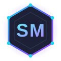

  

<h1 align="center">Hi, I'm Shrujan Mitbavkar 👋</h1>

<h3 align="center">Engineering ideas into reliable software.</h3>

  <strong>IT Engineering Student&nbsp;&nbsp;|&nbsp;&nbsp;Software Development&nbsp;&nbsp;|&nbsp;&nbsp;AI Integration&nbsp;&nbsp;|&nbsp;&nbsp;Software Testing</strong>

  📍 Ponda, Goa, India

  
  
  
  

  

## About Me

I'm an **Information Technology engineering student** at **Shree Rayeshwar Institute of Engineering &amp; Information Technology, Goa**, and a **Software Engineer Intern at Persistent Systems**.

I'm interested in full-stack web development, backend functionality, AI integration, databases, APIs, and software testing. I enjoy building practical applications and learning how to make software reliable and maintainable — from shaping a database schema and exposing it through REST APIs, to testing the workflows that sit on top.

I'm still early in my journey and I like to keep it honest: I build, I break, I fix, and I document what I learn along the way.

  

## Technical Skills

**Programming Languages**

**Frontend**

**Backend**

**Databases**

**AI Integration**

**Tools**

**Testing**

  

## Featured Projects

### SupportSense AI — AI-Based Customer Support Ticket Management System

`Internship` &nbsp; `Team project — 4 engineers` &nbsp; `Backend / AI`

An AI-assisted customer support ticketing platform built by a four-person team during my internship at Persistent Systems. A ticket-lifecycle core (React 18 + Vite on the front end, Node.js / Express on the back end, PostgreSQL for storage) is paired with a Python FastAPI microservice that uses Google Gemini to triage, classify, and route incoming tickets.

**Documented system capabilities**

- AI-assisted ticket creation and classification
- Priority assessment plus customer sentiment / mood analysis
- Resolution-time prediction calibrated against support datasets
- AI-assisted response generation with tone polishing
- Ticket status management with lifecycle (state-transition) validation
- Duplicate-ticket detection and follow-up ticket linking
- Department-specific routing and automated confirmation replies
- Response quality checking and reopened-ticket timeline summaries

> This is an internship / team project. The capabilities above describe the overall system; my personal focus is noted separately below.

**My contribution (as one of four engineers)**

Transactional ticket creation with atomic ticket numbering, status-transition validation, PostgreSQL-backed integration tests running in CI, role-based route authorization, schema and seed automation, and technical documentation.

  

  
  

---

### Bug Tracking System

`Personal project` &nbsp; `Deployed`

A web application for structured bug reporting. A submission form captures the title, description, steps to reproduce, expected vs. actual result, and priority; reports are stored in Firebase Firestore and rendered on a dashboard. Bugs are managed through a simple Open → Closed lifecycle with one-click status changes and deletion, reflected in real time.

**Features**

- Bug report form with field validation
- Firestore-backed dashboard listing every reported bug
- One-click status update from Open to Closed
- Delete bug records
- Real-time updates through Firestore
- Deployed on Firebase Hosting

  

  
  

  

## GitHub Activity

  
  

  Auto-generated from my public GitHub activity.

  

## Currently Learning

  

## Certifications

- **NPTEL — Affective Computing (Elite Certification)** · Score: 79% · 12-week course · Session: January–April 2026 · NPTEL, funded by the Ministry of Education, Government of India
- **Web Designing Competition** · Institution's Innovation Council · 2025
- **ReactJS for Beginners Workshop** · Institution's Innovation Council · 2025

  

## Education

**Bachelor of Engineering — Information Technology**
Shree Rayeshwar Institute of Engineering &amp; Information Technology, Goa
2023 – Present

  

<h2 align="center">Let's Connect</h2>

  I'm always happy to talk about software, testing, AI, and student projects.

  
  
  
  

  

  Engineering ideas into reliable software.

